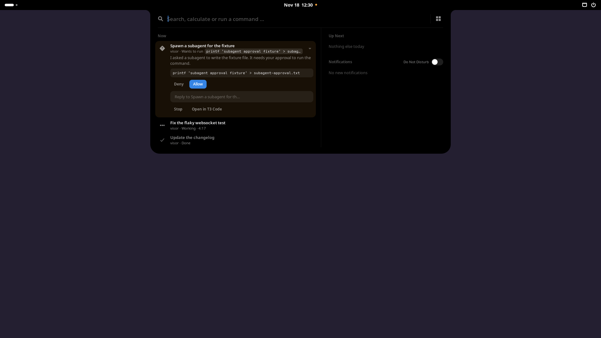

# Visor: T3 Code

**Visor: T3 Code – the agent sessions of T3 Code in the Visor notch for GNOME**

> Requires [Visor](https://github.com/taulit/visor). Shows what your [T3 Code](https://github.com/pingdotgg/t3code) agents are doing, and lets you answer the ones that wait.



This is a module for [Visor](https://github.com/taulit/visor), the notch for GNOME Shell 50/51. It is a GNOME extension of its own (`visor-t3@taulit.github.io`) and takes one place in Visor: rows in **Now**.

## What it shows

- One row per agent session that works, waits or has just finished. Finished sessions leave after two minutes.
- A session that **waits for an approval** turns amber, puts a chip into the peek row and a dot next to the clock, and the notch shows itself briefly (can be turned off). **Allow** and **Deny** are right in the row, but only while the whole command is on screen; a command that is too long or has invisible characters is answered in T3 Code.
- Expand a row to read the last message, reply, stop the run or open the thread in T3 Code (the desktop app when it is installed, the browser otherwise).
- The command `t3 <text>` in the search of Visor sends the text to the thread that was active last, or starts a new thread in its project.

Without a paired server the module shows nothing and makes no request.

## Pair it

1. In T3 Code open **Settings → Sharing & access** and create a link.
2. Open the settings of this extension (the gear next to "T3 Code" in the Modules page of Visor, or `gnome-extensions prefs visor-t3@taulit.github.io`) and paste the link, or the code alone for a server on this machine.

**Disconnect** forgets the token on this machine. The protocol lets a session not revoke itself, so revoke it in T3 Code if you want it invalid.

## Privacy and network

The module has no account, no telemetry and no server of its own.

| Request                                             | When                                                                                                                                                                                                                                                     | Turn it off                                                        |
| --------------------------------------------------- | -------------------------------------------------------------------------------------------------------------------------------------------------------------------------------------------------------------------------------------------------------- | ------------------------------------------------------------------ |
| The T3 Code server you paired: HTTP and a WebSocket | Only after pairing. Without a server address the module reads the address of the server on this machine from `server-runtime.json` below `~/.t3` (or `$T3CODE_HOME`). Plain `http` is accepted for this machine only. A ping every 10 s while connected. | Press Disconnect in the settings, or turn the module off in Visor. |
| The same server, from the settings window           | Only when you press Connect: a request for the server descriptor and the exchange of the pairing code for a token.                                                                                                                                       | Do not pair.                                                       |

The access token is kept in the system keyring (libsecret), not in GSettings, and is sent only to the server that issued it. Neither the pairing code nor the token is ever logged. The protocol is described in [docs/protocol.md](docs/protocol.md).

## Install

From the [GNOME extension store](https://extensions.gnome.org/) (once released), or from a release ZIP:

```sh
gnome-extensions install --force visor-t3@taulit.github.io.shell-extension.zip
```

Log out and in again on Wayland, then enable the extension. Install and enable Visor as well.

## Build and test

Requires Node 22 or newer, pnpm, `glib-compile-schemas` (libglib2.0-bin), gettext and zip.

```sh
pnpm install
pnpm build      # build/ is an installable extension directory
pnpm pack:zip   # dist/<uuid>.shell-extension.zip, the file for extensions.gnome.org
```

| Script                | Purpose                                                                 |
| --------------------- | ----------------------------------------------------------------------- |
| `pnpm build`          | Compile TypeScript and assemble `build/`                                |
| `pnpm pack:zip`       | Build and create the store ZIP                                          |
| `pnpm lint`           | ESLint and `prettier --check`                                           |
| `pnpm typecheck`      | Type-check with `tsc --noEmit`                                          |
| `pnpm test`           | Unit tests of the protocol and the pairing (Vitest)                     |
| `pnpm run test:shell` | The module next to Visor in a sandboxed headless GNOME Shell, see below |
| `pnpm pot`            | Regenerate `po/visor-t3.pot` and merge it into `po/*.po`                |
| `pnpm sync:sdk`       | Update `src/visor/` from the npm package `@taulit/visor-module`         |

The shell tests (`tests/shell/`: `prefs`, `t3`, `leak`) run against the mock server in `tests/mock/`, never against a real one. They use the sandbox of the Visor repository (`scripts/nested.sh`: own HOME, session bus and keyring), so they need a checkout of Visor with `pnpm build` done, at `../visor` or where `VISOR_REPO` points:

```sh
VISOR_REPO=~/src/visor pnpm run test:shell        # all three, about four minutes
pnpm run test:shell t3                            # one of them
```

`src/visor/` holds copies of `connect.js` and the types of `@taulit/visor-module`: a GNOME extension has no `node_modules` at run time and no bundler.

## Not checked

- Approve, deny, reply and stop have run against the mock server only. Against a real T3 Code server (0.1.10 nightly) pairing and the list of sessions were seen to work while this module was still part of Visor; the answers were not tried.
- The translations (nine languages) were not checked by native speakers.
- "T3 Code" is the name of a product of others; whether the store name needs their permission is open.

## Release

Push a tag such as `v1.0.0`: the workflow `.github/workflows/release.yml` builds the ZIP and attaches it to a GitHub release. Upload that ZIP to [extensions.gnome.org](https://extensions.gnome.org/upload/) by hand.

## License

GPL-2.0-or-later, like Visor, which this module was part of.
